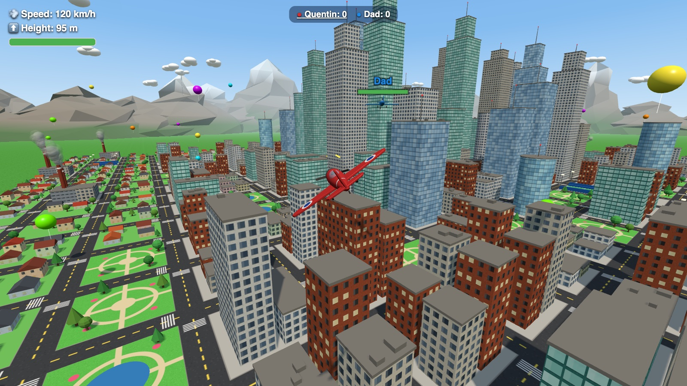

# ✈️ Skys

A little 3D airplane game in the browser. Fly over a big city, pop balloons, drop bombs, and dogfight your friends on the home network!



## Play

```bash
npm install
npm start
```

Open **http://localhost:3000** in Chrome. To play together, open the "On another computer" address that the server prints, on a second computer on the same Wi‑Fi.

**Keys:** `W`/`S` nose up/down (hold `W` for a loop!) · `A`/`D` turn · `Q`/`E` barrel roll (helicopter: up/down) · `Shift` boost · `Space` shoot · `B` bomb · `R` homing missile · `P` choose plane · `C` camera · `M` music · `F` full screen

**Landed at the airport:** `T` shop · `V` get out · **Parachute:** `W`/`A`/`S`/`D` steer

**On foot:** `W`/`A`/`S`/`D` walk · `Shift` run · `Space` shoot · `V` get into a car (steal one!) or a parked plane at the airport · `X` new plane · `H` hide the controls

💰 **Robbing:** walk up to a house, shop, building or the 🏦 bank and press `E`. Then run from the 🚓 police! `G` = new car.

👑 **Boss panel:** press `` ` `` on the computer that runs the server (only that computer can use it).

🎈 Balloon = 1 point · 👾 Robot = 2 points · ✈️💥 Shooting down a plane = 5 points · ⏱ 3-minute rounds

🪙 Earn coins (saved by your name in `profiles.json`) and spend them at the airport shop on upgrades, stickers, the 🌟 golden jet and the 🚁 helicopter.

✈️ 6 planes · 🎁 power-ups · 🏚️ destroyable buildings · 🌅 day and night · 🌧️ weather · 🪂 parachutes · 🚗 traffic and cars · 🌊 beach, sea, ship and lighthouse · 🚶 walk around the city with 150 cars and 180 people · 🗺️ mini-map · 🎈 hot-air balloons and birds · 👾 enemy robots

Made with [three.js](https://threejs.org) and Node.js.
